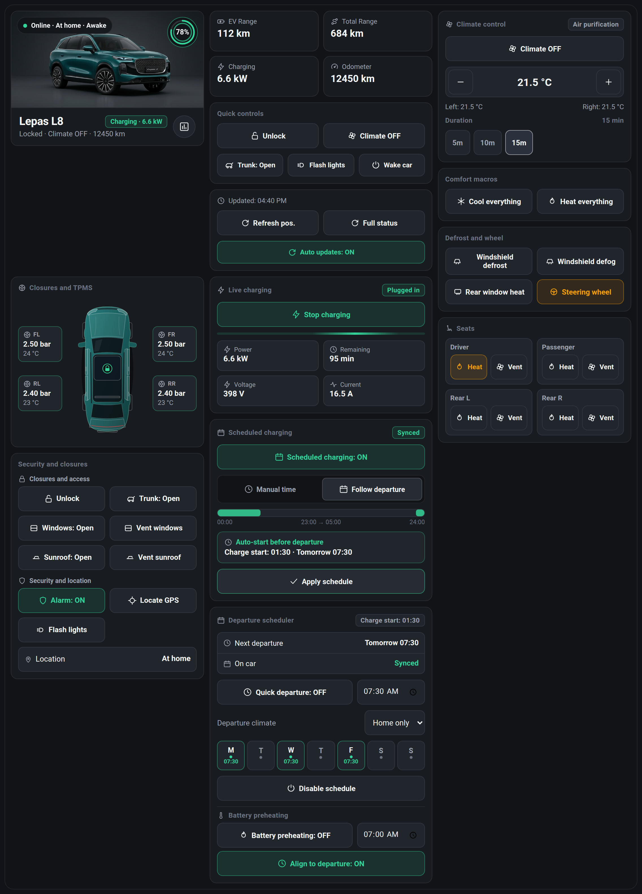
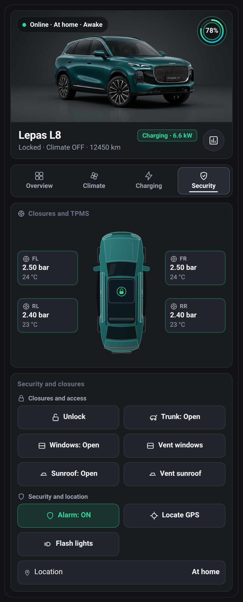
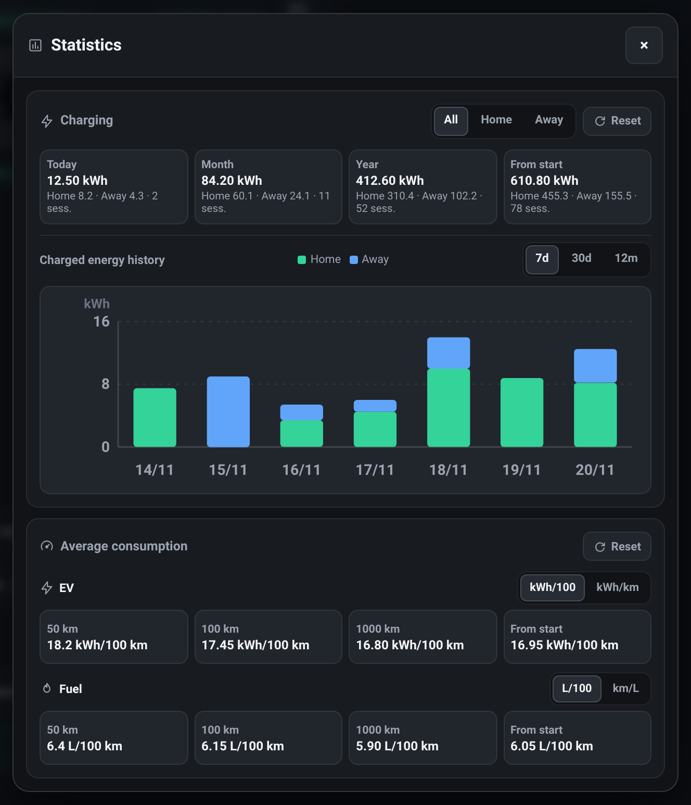

<p align="center">
  <picture>
    <source media="(prefers-color-scheme: dark)" srcset="custom_components/lepas/brand/dark_logo@2x.png">
    
  </picture>
</p>

# Lepas Connect (`custom_components/lepas`)

## Home Assistant custom integration and async Python client for the **Lepas L8** connected vehicle platform (**Chery EU**, `com.chery.eu.lepas`) — currently **v1.32.1** (Home Assistant `2024.1.0+`, Python `3.13+`).

> [!CAUTION]
> **Active Development & Use at Your Own Risk Disclaimer**
> This repository is under active, heavy development (Work in Progress / Experimental) and is an unofficial community project not affiliated with or endorsed by Chery International or Lepas. **Tested Vehicle Scope:** This integration is currently tested exclusively on the **Lepas L8** version distributed in **Italy** (EU platform); other models, trims, or regional variants are unverified. Using this software—including remote vehicle commands and cloud polling that may affect the 12V auxiliary battery—is strictly at your own risk. The authors and contributors assume no liability for any vehicle issues, battery drain, or account restrictions.

## Installation

### Option 1: HACS (Recommended)

[](https://my.home-assistant.io/redirect/hacs_repository/?owner=cavuminfundo&repository=Lepas-HA&category=integration)

1. Open your Home Assistant instance.
2. Navigate to the Home Assistant Community Store (HACS).
3. Click on the top-right menu (⋮).
4. Choose "Custom repositories."
5. Add `https://github.com/cavuminfundo/Lepas-HA` with the category "Integration."
6. Download the Lepas Connect integration.
7. Restart Home Assistant.

> [!NOTE]
> The custom Lovelace card (`custom:lepas-card`) is automatically registered by the integration (`frontend` dependency) and appears directly in Home Assistant's visual dashboard card picker—no manual JavaScript resource configuration is required.

### Option 2: Manual Installation

1. Copy the `custom_components/lepas` directory from this repository into your Home Assistant configuration directory (`config_dir/custom_components/lepas`).
2. Restart Home Assistant.

### Configuration

#### Prerequisites & Account Requirements

Before configuring the integration in Home Assistant, make sure you meet the following requirements:

1. **Active Lepas Europe Account**: An active account in the official Lepas / Chery Europe mobile app (`com.chery.eu.lepas`) with at least one paired or shared vehicle.
   > [!TIP]
   > **Use a Dedicated / Shared (Delegated) Account (Recommended):** Lepas / Chery EU allows only one active session per account. If you configure Home Assistant with your primary account, the official Lepas app on your phone will be signed out whenever Home Assistant authenticates or refreshes the session. To avoid this, create a second Lepas Europe account, sign in once in the official app to activate its profile and set a password (plus a Vehicle Security PIN if remote commands are enabled), then share/authorize the vehicle to that delegated account from your primary account.
2. **Account Password (Mandatory)**: Home Assistant connects exclusively via **Email (or Phone Number + International Country Code) and Password**.
   > [!IMPORTANT]
   > If you registered or normally sign in to the Lepas app using one-time verification codes (OTP email or SMS), you **must set an account password** in the official Lepas mobile app before setting up this integration (*Profile / Settings -> Account & Security -> Set Password*).
3. **Vehicle Security PIN**: The 4- or 6-digit PIN configured in your mobile app, required to execute remote vehicle commands (door locks, climate control, window venting, etc.).
4. **Security & Privacy**: Your password is encrypted and transmitted directly to the Chery/Lepas OAuth endpoint **only once** to mint an OAuth session token. Home Assistant **never stores your password**; subsequent requests use the rotating OAuth refresh token stored locally in your instance.

#### Step-by-Step Setup

1. In Home Assistant, go to **Settings** -> **Devices & Services**.
2. Click **Add Integration** in the bottom right corner.
3. Search for **Lepas Connect**.
4. Choose your region preset (defaults to **Lepas — Europe**; **Chery — Europe** is also available).
5. Enter your **Email or Phone Number**:
   - If using an email address, leave the country code as default.
   - If using a phone number, enter the number digits and specify your international country code (e.g. `39` for Italy) without `+` or spaces.
6. Enter your **Account Password** and your **Vehicle Security PIN** (and optionally customize `battery_capacity_kwh` in setup or integration options).
7. Submit the form. If multiple vehicles are linked to your account, choose the VIN you want to configure.

#### First Start & `unknown` Sensors

> [!NOTE]
> **Why do some telemetry sensors show `unknown` immediately after configuration?**
> When the vehicle is parked and asleep, the onboard telematics module (T-Box) shuts off high-voltage polling to safeguard the 12V auxiliary battery.
> - Full telemetry (odometer, tire pressure, battery status) populates automatically the first time the vehicle is turned on or driven, while `/asr/manager/realtime` snapshots keep physical vehicle states (doors, windows, sunroof, locks, HVAC, charging gun, engine) synced even without spontaneous MQTT pushes.
> - Per-VIN capability discovery (`vmc/queryVehicleAuthority` and `vmc/queryList`) automatically hides unsupported entities for your specific vehicle trim.
> - You can immediately request status updates by pressing the **Wake car** (*Sveglia auto*) or **Refresh full status** (*Aggiorna stato completo*) buttons.
> - You can also enable **Automatic updates** (`switch.lepas_automatic_updates`) in the integration options or directly from the Lovelace card. Keep intervals reasonable (e.g., 60+ minutes while parked) to protect against 12V battery drain.

## Overview & Key Capabilities

- **147 Active Entities Across 11 Platforms**: Covers `sensor` (54), `switch` (30), `binary_sensor` (26 active, plus `binary_sensor.lepas_sunroof_blind` disabled by default), `button` (17), `time` (10), `cover` (3), `number` (2), `select` (2), `climate` (1), `lock` (1), and `device_tracker` (1), with full **English**, **Italian**, and **Dutch** translations.
- **Matte Titanium Lovelace Card (`custom:lepas-card`)**:
  - **Responsive Layouts & Visual Editor**: Built-in `LepasCardEditor` with `auto | compact | cockpit` layouts (vertical 4-tab view on mobile/compact, and an equal-height horizontal 2-column desktop Cockpit pairing Hero + KPIs + Sync + compact **Statistics** summary on the left with a 3-tab operational switcher `Climate | Charging | Security` on the right and a `Scheduled Charging | Departures` switcher inside Charging) plus Sections grid support.
  - **Automatic Vehicle Color & Top-Down Blueprint**: Automatically detects vehicle paint from `vmc/queryList` (`Auto` swatch) or lets you pick from 5 Lepas L8 studio renders (`grey`, `teal`, `violet`, `black`, `white`), synchronized with an animated OEM top-down SUV SVG blueprint (doors, trunk, panoramic sunroof slide vs. tilt-ventilation, and 4-corner TPMS alerts).
  - **Gradient SoC Ring & Integrated Statistics Modal**: Dual concentric SoC ring with a per-level SVG color gradient (`mint → emerald → cyan`, `amber`, or `coral`) and orbital AC / fast DC charging pulse animation, plus an on-demand `<dialog>` **Statistics** modal (`7d | 30d | 12m` charging bar charts for `All | Home | Away` and EV/Hybrid consumption grids with persistent unit toggles and confirmed resets).
  - **Confirmation Modal & `car_in_use` Safety Gating**: Native `<dialog>` confirmation modal for one-shot commands and sensitive actions (`unlock`, `trunk_open`, `windows_open`, `sunroof_open`, `alarm_toggle`), concise Overview command outcome badge (5-minute TTL on success), and automatic `car_in_use` lockout across Climate, Security, and Overview quick actions while driving or when HV safety interlocks apply.
- **Persistent Charging Statistics & Consumption Engine**:
  - **Charging Energy Statistics**: Home Assistant `Store`-backed periodic sensors (`sensor.lepas_charging_energy_today`, `month`, `year`, `from_start` with `home_kwh` / `away_kwh` attributes and `button.lepas_reset_charging_from_start`), plus Energy Dashboard counters (`home_charging_energy`, `away_charging_energy`) using hybrid `chargingPower` integration and SoC-delta gap reconciliation.
  - **Long-Term EV & Hybrid Consumption**: Persistent rolling (`100 km`, `1000 km`) and cumulative (`From start`) tracking separated by `engineState` (`kWh/100 km` for EV driving; `L/100 km` for Hybrid operation, suppressed automatically on pure BEV vehicles), with `button.lepas_reset_consumption_from_start`.
- **Scheduled Departures, Charging & Battery Preheating**:
  - **Weekly & Quick Departure Scheduler**: Per-weekday (`Mon–Sun`) and one-time quick departure switches/times, `select.lepas_departure_climate_mode` (`at_home` / `anywhere` / `off`), `switch.lepas_sync_charge_to_departure`, 12 VIN-filtered departure climate extras, and native vehicle synchronization (`/asc/vehicleControl/appointmentTravel` with automatic UTC-to-local conversion, `switch.lepas_native_departure_sync`, and `button.lepas_apply_departure_schedule`).
  - **Scheduled Charging & Battery Preheat**: Weekday preset/custom charging schedules (`select.lepas_charge_days`, `button.lepas_apply_charging_schedule`, `sensor.lepas_scheduled_charging_window`) and plug-in battery pack preheating (`switch.lepas_battery_pack_heat`, `time.lepas_battery_pack_heat_time`, `switch.lepas_sync_battery_heat_to_departure`).
- **Climate, Closures & Realtime Reconciliation**:
  - **Climate & Comfort**: `climate.lepas_climate` synced with `frontSetTempLeft` / `frontSetTempRight` and vehicle-declared `maxAirDuration` (`5 / 10 / 15` min on Lepas L8), seat heating/ventilation, steering/defrost controls, and immediate ECU `reason` rollback (`car_in_use` aware).
  - **Closures & Lock Auto-Sync**: Remote locks, windows, panoramic sunroof, trunk, horn/lights, and remote start with guarded `A07900` wake-and-retry, automatic closure sync on vehicle lock (`sunroofState`, `sunshadeState`, and 4 windows), and fast passive `CMD_PROBE` (`+25 s`, `+90 s`) realtime settlement.
- **GPS Location, 12V Battery Guard & Blueprints**: Tracks vehicle location (`device_tracker`) and `binary_sensor.lepas_at_home`, adapts polling to preserve the 12V auxiliary battery, and includes failure-notification blueprints in `blueprints/automation/lepas/` (`failed_command.yaml`, `comando_fallito.yaml`).

## Dashboard Preview (`custom:lepas-card`)

*Synthetic preview renders of `custom:lepas-card` showing the equal-height horizontal 2-column Cockpit view, mobile/compact Security & TPMS blueprint tab, and integrated Statistics modal.*

<p align="center">
  
</p>

| Security & Top-Down Blueprint (Compact) | Integrated Statistics Modal |
| :---: | :---: |
|  |  |

## Services

- `lepas.set_quick_departure`: Configure or toggle the one-time quick departure schedule (with optional charging sync and native vehicle apply).
- `lepas.set_charging_schedule`: Configure scheduled charging start time, duration, weekdays, and optionally apply it to the vehicle.
- `lepas.set_departure_climate_extras`: Configure the VIN-supported comfort extras activated on scheduled departure.
- `lepas.set_battery_pack_heat`: Enable/disable plug-in battery pack preheating and optionally sync it to departure time.
- `lepas.disable_departure_schedule`: Turn off the active departure schedule on the vehicle, weekly/quick HA switches, and native auto-sync.

## Repository Documentation Index

- [.agents/AGENTS.md](.agents/AGENTS.md)
- [.agents/memory/antibodies/lepas.md](.agents/memory/antibodies/lepas.md)
- [docs/architecture.md](docs/architecture.md)
- [docs/roadmap.md](docs/roadmap.md)
- [docs/code-implementation.md](docs/code-implementation.md)
- [docs/tested-models.md](docs/tested-models.md)
- [CHANGELOG.md](CHANGELOG.md)

## Development & Quality Gates

To verify the integration, Lovelace card, and code style locally (all tests run offline via `tests/conftest.py` using `requirements_test.txt`):

- **Python test suite**:
  ```bash
  .venv/bin/pytest -q --tb=short --maxfail=2
  # or inside an active virtual environment / CI:
  pytest tests/ -q
  ```
- **Lovelace card tests & syntax check** (ensures older Android System WebView compatibility):
  ```bash
  node --test tests/lepas_card.test.mjs
  node --check custom_components/lepas/lovelace/lepas-card.js
  ```
- **Ruff lint & format check** (optional local style check):
  ```bash
  uv run --no-project --with ruff ruff check custom_components/ tests/
  uv run --no-project --with ruff ruff format --check custom_components/ tests/
  ```
